# Tenantry

**Microsoft 365 administration in one fast desktop app.**

Users, mailboxes, groups, SharePoint, devices, security and compliance, without switching between
seven admin portals. Lists search as you type because Tenantry keeps an encrypted copy of your
tenant on your own computer, and every change waits in one place for you to review before anything
is sent to Microsoft.

[](https://github.com/levinium/Tenantry/releases/latest)
[](https://github.com/levinium/Tenantry/releases)


[](https://github.com/sponsors/levinium)

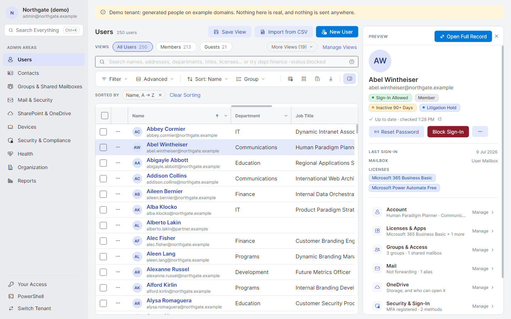

**Status: early.** Everything below works today against real tenants, and is tested on one
continuously. Expect rough edges, and tell us about them in
[Issues](https://github.com/levinium/Tenantry/issues).

## Download

| For | Download |
| --- | --- |
| Windows, 64-bit (most PCs) | **[Tenantry-win-x64-Setup.exe](https://github.com/levinium/Tenantry/releases/latest/download/Tenantry-win-x64-Setup.exe)** (about 70 MB) |
| Windows on Arm | **[Tenantry-win-arm64-Setup.exe](https://github.com/levinium/Tenantry/releases/latest/download/Tenantry-win-arm64-Setup.exe)** (about 65 MB) |
| Mac with Apple silicon (M1 and later) | **[Tenantry-osx-arm64-Setup.pkg](https://github.com/levinium/Tenantry/releases/latest/download/Tenantry-osx-arm64-Setup.pkg)** (about 58 MB) |
| Mac with an Intel processor | **[Tenantry-osx-x64-Setup.pkg](https://github.com/levinium/Tenantry/releases/latest/download/Tenantry-osx-x64-Setup.pkg)** (about 60 MB) |
| Linux, 64-bit | **[Tenantry-linux-x64.AppImage](https://github.com/levinium/Tenantry/releases/latest/download/Tenantry-linux-x64.AppImage)** (about 60 MB) |

Portable zips for Windows and macOS are on the [releases page](https://github.com/levinium/Tenantry/releases/latest)
too, for running it without installing.

### Windows

Run the Setup file. It installs for you alone, without administrator rights, and adds Tenantry to
the Start menu. You need Windows 10 or 11.

Builds are not code-signed yet, so Windows SmartScreen warns before the first run. Choose
**More info**, then **Run anyway**, or read the source and build it yourself.

### Mac

Open the `.pkg` and follow the installer. Not sure which Mac you have? Open the Apple menu and choose
**About This Mac**: a chip whose name starts with "Apple M" is Apple silicon.

The installer is not notarized by Apple yet, so macOS says it can't verify it the first time. Choose
**Done**, open **System Settings** › **Privacy & Security**, scroll down, choose **Open Anyway** next
to the message about Tenantry, and confirm. You only need to do this once.

### Linux

Make the AppImage executable and run it:

```sh
chmod +x Tenantry-linux-x64.AppImage
./Tenantry-linux-x64.AppImage
```

If it doesn't start, install your distribution's `libfuse2` package (AppImages need it).

### Updates

Tenantry keeps itself up to date. It checks GitHub for a newer release when it opens and every few
hours, downloads it in the background, and then offers **Update to …** in the sidebar: one click
installs it and reopens Tenantry. **Settings** › **Updates** shows the version you have and checks
straight away. The check is one request to GitHub; nothing about you or your tenant is sent.

## Getting started

1. Open Tenantry and choose **Add Tenant**, or **Explore the Demo Tenant** to look around first with
   made-up people on example domains.
2. Choose **Set It Up for Me** and sign in as an admin with the **Cloud Application Administrator**
   role or higher. Tenantry creates its own app registration in your tenant, and shows exactly what
   it changes before it does anything. Prefer to do that yourself? **I'll Create It Myself** gives
   you a PowerShell script, or the portal steps, and asks for the two IDs at the end.
3. Sign in. Tenantry reads your tenant into its local copy (a minute or two for most tenants) and
   keeps it up to date while it's open.

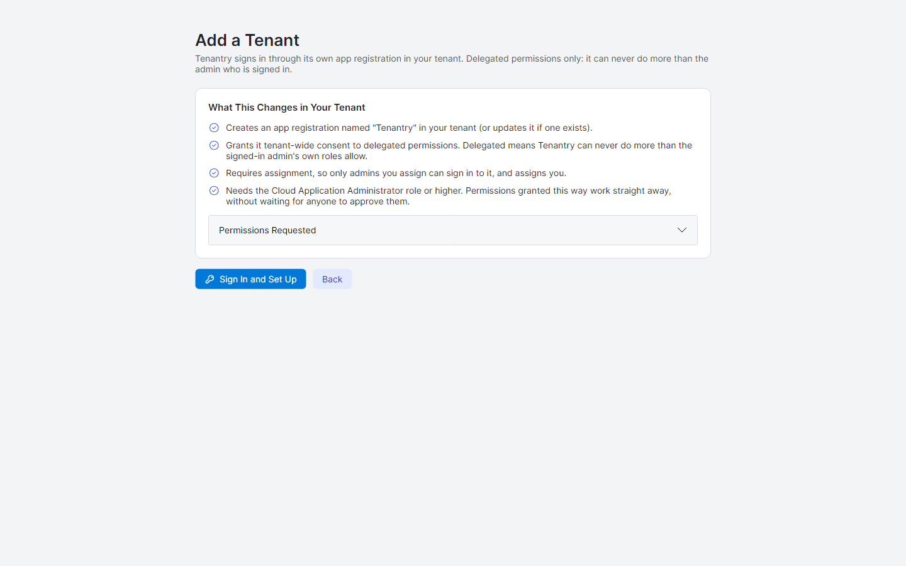

Tenantry uses **delegated permissions only**: it can never do more than the admin who is signed in.
Multi-factor authentication, Conditional Access and PIM apply to it like any other sign-in. Features
your roles or licenses don't allow appear switched off, with the reason, rather than failing when you
use them.

## What it does differently

| In the admin portals | In Tenantry |
| --- | --- |
| Seven portals, each with its own search and navigation | One app: areas down the side, records open as tabs, and **Ctrl+K** searches every user, group, device and site at once |
| Every filter or sort waits for the server | Lists come from a local copy, so tens of thousands of rows filter, sort, group and scroll as you type |
| A change happens as soon as you press Save, one blade at a time | Every change goes to **Pending Changes** first, shown as before → after. Remove any of them, then apply them together; Tenantry reads each one back to confirm it took |
| Editing many people means PowerShell or a CSV upload elsewhere | Tick rows and the preview becomes a selection panel: fields that differ say *Mixed*, and actions apply to everyone ticked. CSV import is built in |
| Offboarding is a checklist on a wiki | **Offboard** is one checklist (block, sign out, remove methods, roles and groups, convert the mailbox, hand over access) for one person or a selection |
| Sign-in and audit logs are kept for 30 days | Tenantry keeps them on your computer, encrypted, for as long as you choose (a year by default) |
| Mail flow rules are dialogs of conditions | Rules read as sentences, with a plain-words summary, starter templates, and new rules starting in Test mode |
| A new Conditional Access policy can lock you out the moment it's on | New policies start **report-only**, leave you out by default, and What If shows which policies a sign-in meets and why |
| "What would this be in PowerShell?" | **Show PowerShell** on any pending change, and a PowerShell console already signed in to your tenant |
| Finding a file someone lost means opening sites one at a time, if you can open them at all | **Find Files** looks through the OneDrives and sites you choose, or everywhere, recycle bins included, and people who have left too. Restore, download, share or copy what it finds |
| Licensed-only features appear and then fail | They show switched off, saying which license or role they need |

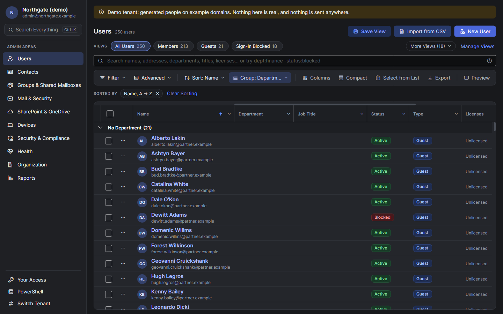

## What it covers

- **Users and contacts:** account details, licenses and apps, groups and access, mail, OneDrive,
  sign-in methods and MFA, sign-in history, devices and activity. Workflows for offboarding and for
  responding to a compromised account.
- **Groups and shared mailboxes:** owners and members (Microsoft 365, security, distribution and
  mail-enabled groups), dynamic rules tested against a person, and who can open or send from a shared
  mailbox.
- **Mail and security:** quarantine and release requests, message trace with delivery errors
  explained and messages sent to Microsoft as junk, phishing or not junk, mail flow rules, the Tenant Allow/Block List, threat policies, DKIM, SPF and DMARC,
  connectors, domains, alerts and mail flow reports.
- **SharePoint and OneDrive:** sites and OneDrives, permissions, sharing, storage limits, lock,
  archive, delete and restore.
- **Find Files:** look for lost files by name (contains, starts with or a regular expression), type
  or extension, when they changed, who changed them, size or folder. Search the OneDrives and sites
  you choose, or everywhere (Microsoft Purview finds which places have matches), including each
  place's recycle bins and the OneDrives of people who have left. Places you can't open offer to add
  you as a site admin just for the search. Then restore, download, give someone access, or copy
  files into another OneDrive or site.
- **Devices:** Entra and Intune devices together, with remote actions, compliance, apps, BitLocker
  and LAPS; Autopilot; and Intune policies, including a settings catalog editor.
- **Security and compliance:** admin roles and PIM, Conditional Access, named locations, app
  registrations and enterprise apps (secrets, certificates, permissions, single sign-on),
  authentication methods, risky users, the audit log, eDiscovery, retention, sensitivity labels and
  DLP.
- **Health and organization:** service health, Message Center, subscriptions and usage, organization
  and identity settings, and Teams with its policies.
- **Reports:** health checks that count what needs a look (no MFA, forwarding outside, inactive
  accounts, unlicensed mailboxes) and open the matching list, plus the change log.

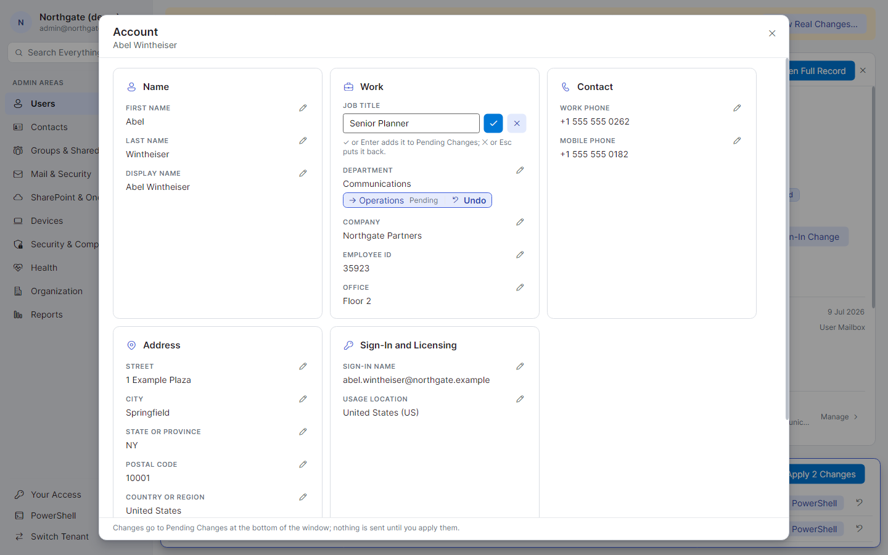

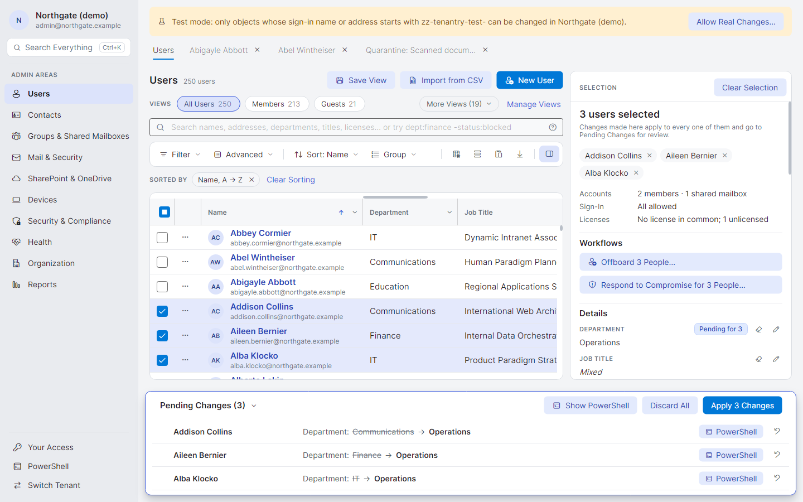

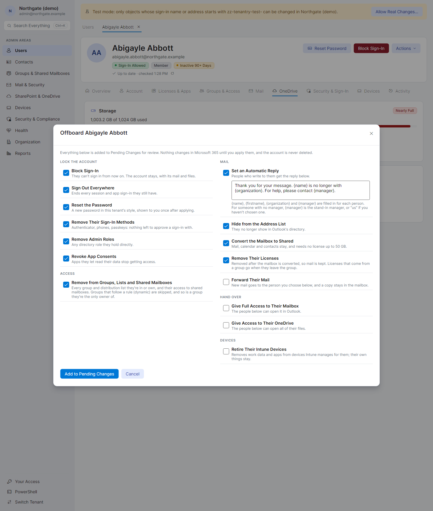

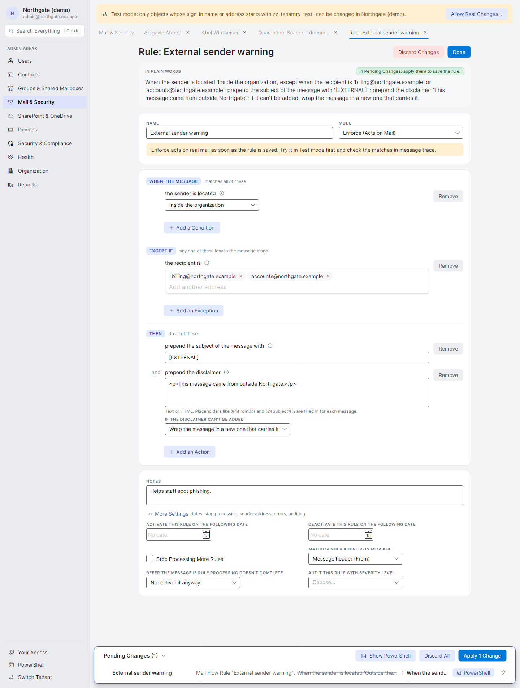

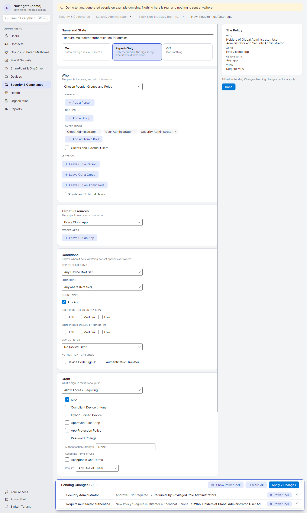

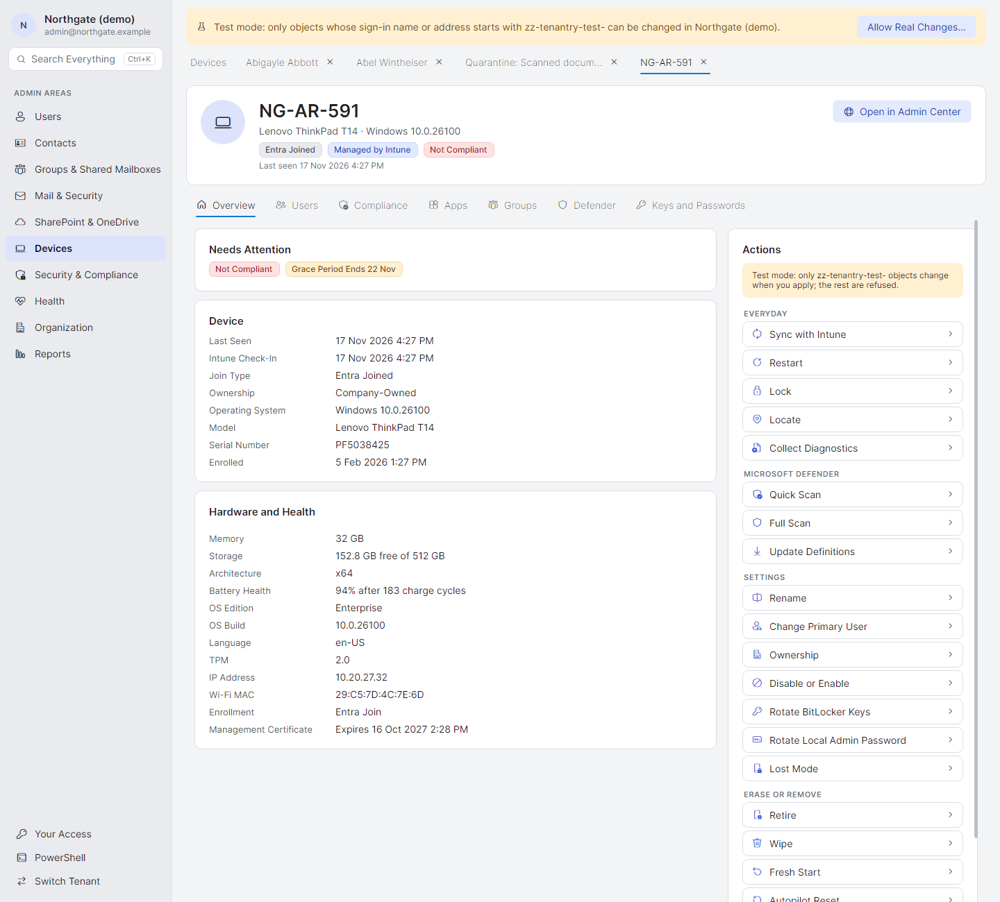

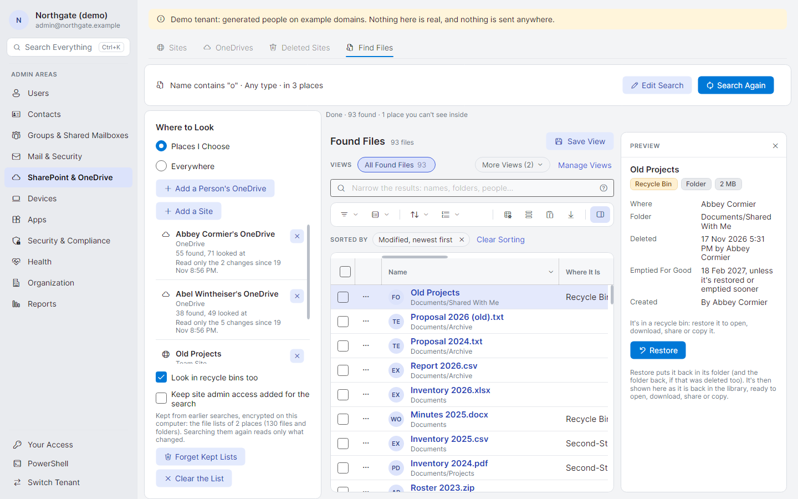

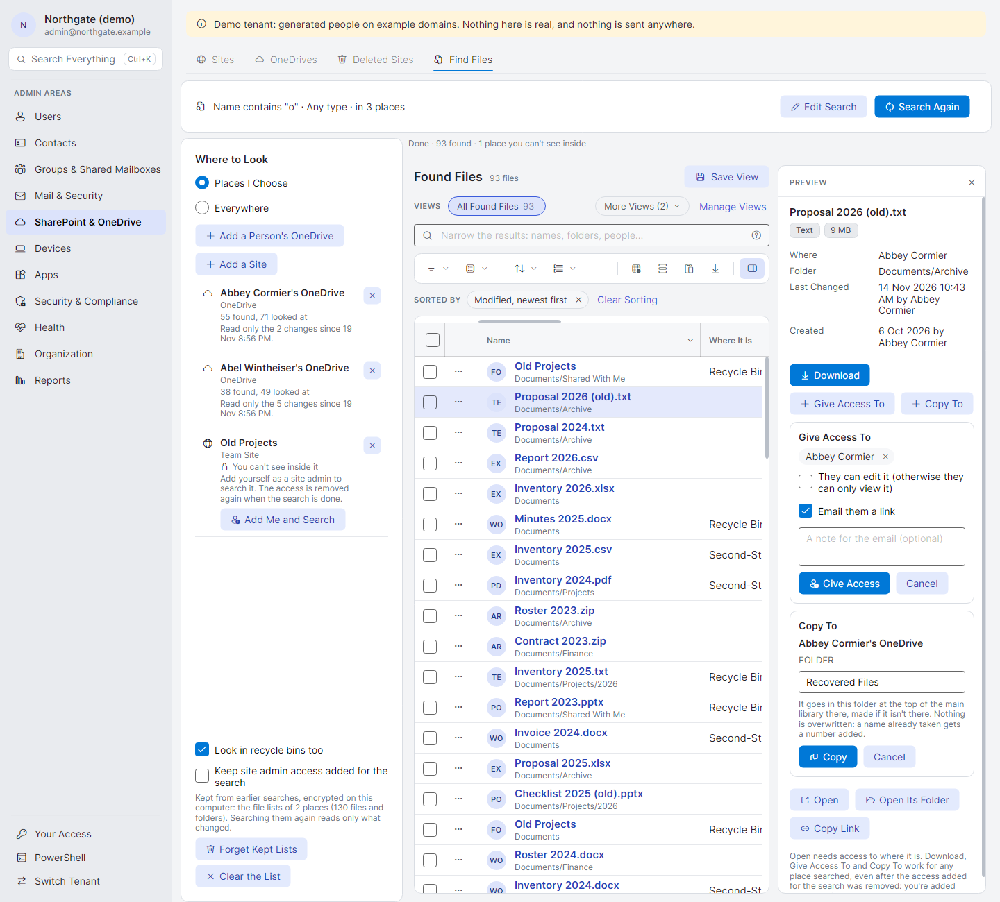

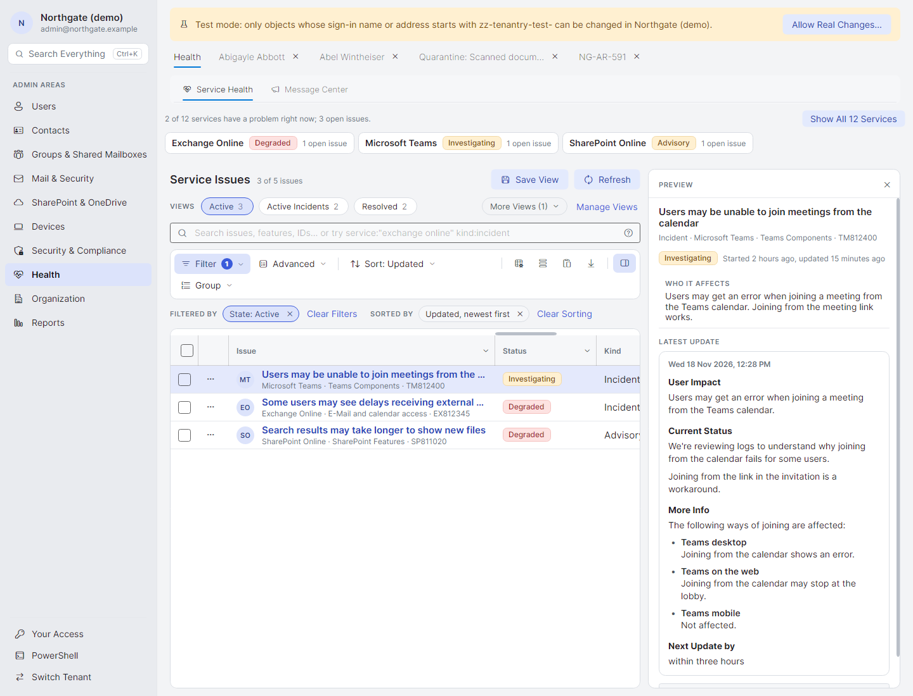

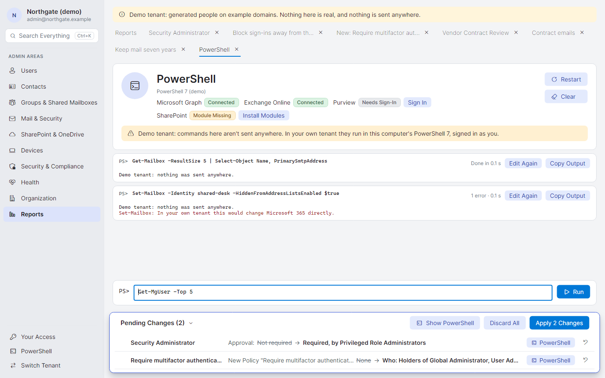

## Your data stays with you

- **No server in between.** Tenantry talks to Microsoft's APIs directly from your computer, signed
  in as you, and to GitHub only to check for updates. There is no Tenantry service, no telemetry and
  no crash upload.
- **The local copy is encrypted.** Each tenant's copy is a database encrypted with a key kept in your
  operating system's secret store (Windows data protection, the macOS Keychain, or the Linux
  keyring), and sign-in tokens are kept the same way.
- **Find Files keeps what it reads.** The file lists of places you've searched stay in the same
  encrypted copy, so searching them again reads only what changed. **Forget Kept Lists** deletes
  them. They are never shown for a place you can no longer open.
- **New passwords are shown once.** Passwords Tenantry makes when resetting someone are shown to you
  after applying and never stored.
- **It's kept in your user folder:** `%APPDATA%\Tenantry` on Windows, `~/.config/Tenantry` on macOS
  and Linux. Removing a tenant from the start screen deletes its copy.

## Optional: PowerShell

The built-in console and **Show PowerShell** use **PowerShell 7** installed on your computer
([get it from Microsoft](https://learn.microsoft.com/powershell/scripting/install/installing-powershell)).
The console signs in to Microsoft Graph, Exchange Online, Purview and SharePoint with your Tenantry
sign-in, and **Install Modules** adds any of their PowerShell modules it's missing. Everything else in
Tenantry works without it.

## Running it from source

Requires the .NET 10 SDK.

```sh
dotnet test Tenantry.slnx
dotnet run --project src/Tenantry.App
```

Development builds start in **Test mode**: they change only objects whose sign-in name or address starts
with `zz-tenantry-test-`, and refuse everything else before it's sent. **Allow
Real Changes** turns that off for one tenant, after you type its name. Builds from a release start
with Test mode off.

### Screenshots and checks

`tools/Tenantry.Snapshots` renders every screen from the demo tenant, in light and dark, with no
window, into `snapshots/`. With `--behavior-check` it clicks through the app instead and checks what
each click does.

```sh
dotnet run --project tools/Tenantry.Snapshots -c Release
dotnet run --project tools/Tenantry.Snapshots -c Release -- --behavior-check
```

Set `TENANTRY_DEMO_USERS=20000` to make the demo tenant that size, and `TENANTRY_CHECK=Scale:` to run
only the speed checks.

## Contributing: the leak guard

Tenantry is developed against real tenants, and nothing from a real tenant may enter this
repository. Git hooks in `tools/hooks` refuse any commit or push that contains a term from a
private denylist kept **outside** the repository (the terms themselves are sensitive).

One-time setup after cloning:

```sh
git config core.hooksPath tools/hooks
```

Then create the denylist, one case-insensitive term per line (organisation names, domains, tenant
IDs). An empty file is allowed; a missing one blocks commits.

| OS | Location |
|---|---|
| Windows | `%APPDATA%\tenantry-dev\denylist.txt` |
| macOS, Linux | `~/.config/tenantry-dev/denylist.txt` |

Set `TENANTRY_DENYLIST` to use a different path.

Other rules:

- Test fixtures and screenshots use the demo tenant or reserved `.example` domains only.
- Tenant settings, caches and logs live in the user's app-data folder, never in the repo.

## License

MIT. See [LICENSE](LICENSE). Built with [Avalonia](https://avaloniaui.net) (MIT),
[FluentIcons](https://github.com/davidxuang/FluentIcons) (MIT),
[CommunityToolkit.Mvvm](https://github.com/CommunityToolkit/dotnet) (MIT),
[MSAL.NET](https://github.com/AzureAD/microsoft-authentication-library-for-dotnet) (MIT),
[SQLite3 Multiple Ciphers](https://github.com/utelle/SQLite3MultipleCiphers) (MIT),
[DnsClient.NET](https://github.com/MichaCo/DnsClient.NET) (Apache 2.0),
[QRCoder](https://github.com/codebude/QRCoder) (MIT) and [Velopack](https://velopack.io) (MIT).
